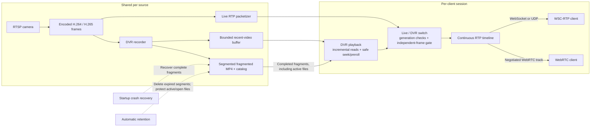

### Media Server

Optimized for realtime streaming and live-rewind (DVR).



Each client has its own playback state, switch and RTP timeline. The source,
recent-video buffer and recordings are shared. Each session uses either WSC-RTP
or WebRTC.

See [DVR playback, codec changes, recovery and retention](docs/dvr-playback-and-storage.md) for playback states and storage configuration.

## Running the server

Build the binary, then run it from the `media-server` directory so its `assets/`
placeholder files are available:

```sh
cargo build --release -p media-server
cd media-server
../target/release/media-server --help
../target/release/media-server --bind-address 127.0.0.1 --port 8009
```

All server startup options are command-line arguments. Both `--option value` and
`--option=value` are accepted. Unknown options, duplicate options, missing values
and invalid values fail startup instead of silently falling back to defaults.

| Argument | Default | Meaning |
| --- | --- | --- |
| `--bind-address <IP>` | `0.0.0.0` | IPv4 or IPv6 interface to listen on. Supply the IP only; use `--port` for the port. |
| `--port <PORT>` | `8009` | HTTP/WebSocket port, from `0` to `65535`. `0` selects a free port, printed in the startup log. |
| `--dvr-dir <PATH>` | `dvr` | Shared recording directory used by recording, playback, startup recovery and retention. |
| `--dvr-retention-secs <SECONDS>` | `0` | Delete completed recordings whose end time is older than this age. `0` disables automatic deletion. |
| `--retention-check-interval-secs <SECONDS>` | `60` | Positive interval between cleanup runs. When retention is enabled, its first run is immediate. |
| `--log-dir <PATH>` | `logs` | Directory for daily `media-server.log.*` files. Logs also go to stdout. |
| `--log-filter <FILTER>` | `info` | Tracing filter, such as `debug` or `info,media_server=debug`. |
| `--help`, `-h` | — | Print available options and exit, without initializing media dependencies or storage. |
| `--version`, `-V` | — | Print the binary version and exit. |

Paths are relative to the working directory unless absolute. Storage and logging
directories must be writable. Crash recovery always runs at startup; active,
pending, quarantined and open playback files are protected from retention deletion.
Quarantined files need manual review. Retention is disabled by default.

For seven-day retention and custom directories:

```sh
../target/release/media-server \
  --bind-address 0.0.0.0 \
  --port 8009 \
  --dvr-dir ./recordings \
  --dvr-retention-secs 604800 \
  --retention-check-interval-secs 60 \
  --log-dir ./logs \
  --log-filter 'info,media_server=debug'
```

For IPv6 loopback, use `--bind-address ::1 --port 8009`.

`BIND_ADDRESS`, `DVR_RETENTION_SECS` and `RUST_LOG` no longer configure the binary.
Replace them with `--bind-address` plus `--port`, `--dvr-retention-secs`, and
`--log-filter`, respectively. Environment variables used only by dependency tools
or optional test probes are not server startup configuration.

Streams and per-client choices are configured through the HTTP/WebSocket API.
For example, `force_websocket_transport=true` and `playback_events=true` are
per-connection query parameters, not process-wide startup flags.

## Pre-alarm HTTP imports

Enable the internal import API with a file containing a nonempty bearer token:

```sh
cd media-server
cargo run -- --imports-token-file /run/secrets/media-import-token \
  --prealarm-dir /var/lib/media/prealarm --prealarm-retention-secs 2592000
```

The imported recording root defaults to `prealarm`; live DVR still defaults to
`dvr`. These roots must be separate and non-nested. Recovery runs on both roots.
Pre-alarm retention defaults to 30 days; `--prealarm-retention-secs 0` disables
its periodic deletion independently of live DVR retention.

Import routes are absent unless `--imports-token-file` is configured. Every
import request, including the WebSocket upgrade, requires
`Authorization: Bearer <token>`. These internal credentials do not replace the
separate authentication work needed for browser playback and the existing API.

| Method | Path | Behavior |
| --- | --- | --- |
| POST | `/imports` | Prepare a background HTTP import; returns 202 and its status |
| GET | `/imports/{import_id}` | Current status, progress, error code and result |
| DELETE | `/imports/{import_id}` | Cancel an attempt and wait for its cleanup |
| GET | `/imports/ws` | WebSocket carrying status/progress events for all imports |
| POST | `/prealarm/exists` | Given `{"ids":["prealarm:incident:source"]}`, return the IDs still present |

A POST body has this shape (credentials below are placeholders):

```json
{
  "import_id": "incident-source-job",
  "media_source_id": "prealarm:incident:source",
  "kind": "http",
  "url": "http://camera/dataloader.cgi?dw=sd&filename=recording&starttime=...&endtime=...",
  "creds": {"username": "device-user", "password": "device-password"},
  "from_ms": 1700000300000,
  "to_ms": 1700000319000,
  "clock_offset_ms": 300000,
  "http_response_profile": "milesight_camera"
}
```

`from_ms` and `to_ms` are device-clock UTC milliseconds. The server timeline
starts at `from_ms - clock_offset_ms`; positive offset means the device is ahead.
HTTP vendor export/keyframe rounding still limits the accuracy of absolute
capture-time alignment. Results contain `actual_start_ms`, `actual_end_ms` and
`codec` (`h264` or `h265`), derived from the finalized DVR sidecars.

The response profile defaults to `standard` for NVR exports. Use
`milesight_camera` only for native `/dataloader.cgi` exports: the tested firmware
inserts a second HTTP status line inside its response headers. That profile
ignores invalid header lines, with a regression test reproducing the real
response. Redirects are not followed, credentials stay separate from URLs, and
TLS validation remains enabled.

Imports have a 120-second requested-window limit, 512 MiB download limit,
120-second HTTP deadline and 180-second overall deadline. At most four jobs run
at once, with one per device endpoint. Unknown Content-Length means unknown
percentage. Progress is emitted at most approximately once a second; status
transitions are emitted immediately. On WebSocket lag/disconnect, reconcile
known jobs with GET. Job status is in memory; completed media is rediscovered
from its sidecars after restart.

Reposting an unfinished ID cancels and cleans the previous attempt before
starting another. A completed, still-present source is reused without fetching
the vendor URL again. Private staging trees are published atomically, and failed
attempts are removed. Owned staging trees abandoned by a crash become eligible
for cleanup after one hour, on startup, or on a pre-alarm maintenance tick.

Only H.264/H.265 video is retained. Audio is discarded. Imports start at a usable
IDR with codec parameters, preserve valid PTS/DTS, repair missing/broken decode
timestamps using codec/nominal frame rate, and fail if no usable rate exists.
All normalized frames must be readable through the DVR reader before publication.
Imported fragmented MP4 uses a finalized layout to preserve reordered frames;
live recording retains its existing layout for reads while files are growing.

The `prealarm:` namespace is reserved and cannot be registered as a live RTSP
source. This stage supplies imports and verifies seek/end behavior through the
DVR player. Public playback-only WebRTC/WSC-RTP registration, browser playback
authorization, generic ONVIF replay and backend job/database integration remain
separate work; importing a clip does not expose it through anonymous live routes.
