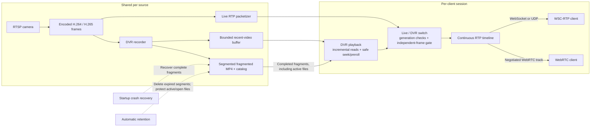

### Media Server

Optimized for realtime streaming and live-rewind (DVR).



Each client has its own playback state, switch and RTP timeline. The source,
recent-video buffer and recordings are shared. Each session uses either WSC-RTP
or WebRTC.

See [DVR playback, codec changes, recovery and retention](docs/dvr-playback-and-storage.md) for playback states and storage configuration.

## Running the server

Build the binary, then run it from the `media-server` directory so its `assets/`
placeholder files are available:

```sh
cargo build --release -p media-server
cd media-server
../target/release/media-server --help
../target/release/media-server --bind-address 127.0.0.1 --port 8009
```

All server startup options are command-line arguments. Both `--option value` and
`--option=value` are accepted. Unknown options, duplicate options, missing values
and invalid values fail startup instead of silently falling back to defaults.

| Argument | Default | Meaning |
| --- | --- | --- |
| `--bind-address <IP>` | `0.0.0.0` | IPv4 or IPv6 interface to listen on. Supply the IP only; use `--port` for the port. |
| `--port <PORT>` | `8009` | HTTP/WebSocket port, from `0` to `65535`. `0` selects a free port, printed in the startup log. |
| `--dvr-dir <PATH>` | `dvr` | Shared recording directory used by recording, playback, startup recovery and retention. |
| `--dvr-retention-secs <SECONDS>` | `0` | Delete completed recordings whose end time is older than this age. `0` disables automatic deletion. |
| `--retention-check-interval-secs <SECONDS>` | `60` | Positive interval between cleanup runs. When retention is enabled, its first run is immediate. |
| `--log-dir <PATH>` | `logs` | Directory for daily `media-server.log.*` files. Logs also go to stdout. |
| `--log-filter <FILTER>` | `info` | Tracing filter, such as `debug` or `info,media_server=debug`. |
| `--help`, `-h` | — | Print available options and exit, without initializing media dependencies or storage. |
| `--version`, `-V` | — | Print the binary version and exit. |

Paths are relative to the working directory unless absolute. Storage and logging
directories must be writable. Crash recovery always runs at startup; active,
pending, quarantined and open playback files are protected from retention deletion.
Quarantined files need manual review. Retention is disabled by default.

For seven-day retention and custom directories:

```sh
../target/release/media-server \
  --bind-address 0.0.0.0 \
  --port 8009 \
  --dvr-dir ./recordings \
  --dvr-retention-secs 604800 \
  --retention-check-interval-secs 60 \
  --log-dir ./logs \
  --log-filter 'info,media_server=debug'
```

For IPv6 loopback, use `--bind-address ::1 --port 8009`.

`BIND_ADDRESS`, `DVR_RETENTION_SECS` and `RUST_LOG` no longer configure the binary.
Replace them with `--bind-address` plus `--port`, `--dvr-retention-secs`, and
`--log-filter`, respectively. Environment variables used only by dependency tools
or optional test probes are not server startup configuration.

Streams and per-client choices are configured through the HTTP/WebSocket API.
For example, `force_websocket_transport=true` and `playback_events=true` are
per-connection query parameters, not process-wide startup flags.
